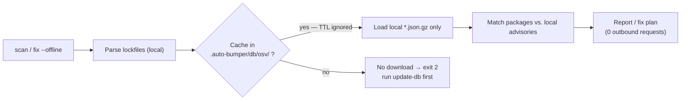

 

# Auto-Bumper

**Local-first polyglot dependency scanner & auto-fixer.** Scans npm, Rust, Python, and Java projects for vulnerabilities using the [OSV (Open Source Vulnerabilities)](https://osv.dev/) database — no LLM, no API keys, no cloud after initial download. Runs offline once cached.


---

## At a Glance

| Feature | Detail |
|---------|--------|
| **What it does** | Finds vulnerable dependencies → proposes minimal version bumps → edits your manifest files |
| **How it knows** | OSV dumps, GitHub's reviewed Maven list, Snyk public pages, and local advisory files. Details below |
| **Where data lives** | `.auto-bumper/db/` in the target project — `osv/` for advisory caches, `bom/` for platform BOM maps |
| **Network needed?** | Only to refresh advisory data and, for Maven/Gradle, to look up published releases. `--offline` skips the network. Details below |
| **LLM involved?** | No. Fix versions come from advisory metadata and, when OSV has no GA fix, from published releases |

**Advisory sources**

- OSV dumps (~few MB per ecosystem, gzipped) from the public [osv.dev GCS bucket](https://google.github.io/osv.dev/data/), cached locally.
- Reviewed Maven advisories from the GitHub global advisory list. Cached, refreshed by `updated` time, and read again with `--offline`.
- Snyk's public per-package pages for Maven and npm. One request per unique package, cached 7 days.
- Local files in the package `local-advisories/` and in `<project>/local-advisories/`, for disclosures the three sources above have not ingested yet.
- `AUTO_BUMPER_SUPPLEMENTAL=off` (or `0` / `false`, case-insensitive) turns off GitHub, the orphan-CVE bridge, and Snyk. The scan then uses the OSV dump plus local advisories only.

**Network**

- Each online run sends a lightweight HEAD probe (no project data) per OSV ecosystem and re-downloads only when the remote dump changed. If the probe fails, the local cache is used (7-day TTL).
- Snyk: one public page per unique Maven/npm package not yet cached. Package coordinates are sent. Nothing else. 7-day TTL.
- Matching runs on the local DB. The full dependency tree is never sent.
- `--offline` skips the probes too.

---

## How It Works

```
┌─────────────────────────────────────────────────────────────────────┐
│                              SCAN FLOW                              │
├─────────────────────────────────────────────────────────────────────┤
│                                                                     │
│  Lockfile scanner                                                   │
│        │                                                            │
│        ▼                                                            │
│  Parse packages (pure TS)  -->  PackageRef[]                        │
│        │                                                            │
│        ▼                                                            │
│  Detect ecosystems (npm / pypi / maven / gradle)                    │
│        │                                                            │
│        ▼                                                            │
│  .auto-bumper/db/osv/                                               │
│    cache miss  -->  download OSV zip from GCS (gzip)                │
│    cache hit   -->  read local advisory JSON                        │
│    stale       -->  update-db                                       │
│        │                                                            │
│        ▼                                                            │
│  AdvisoryEntry[]                                                    │
│        │                                                            │
│        ▼                                                            │
│  MATCH ENGINE (matcher.ts)                                          │
│    Maven: compareMavenVersion + matchesMavenRange                   │
│    PyPI:  comparePEP440 + matchesPEP440Range                        │
│    npm/Rust: semver ranges                                          │
│        │                                                            │
│        ▼                                                            │
│  Finding[] sorted by severity                                       │
│        │                                                            │
│        ▼                                                            │
│  REPORTER (reporter.ts)                                             │
│    --format markdown | json                                         │
└─────────────────────────────────────────────────────────────────────┘


┌─────────────────────────────────────────────────────────────────────┐
│                              FIX FLOW                               │
├─────────────────────────────────────────────────────────────────────┤
│                                                                     │
│  Finding[]                                                          │
│        │                                                            │
│        ▼                                                            │
│  buildFixPlan() (fixer.ts)                                          │
│    group by package, pick minimal fix version                       │
│    detectMavenRenames() — OSV + known group migrations              │
│    family guard — cross-major splits stay on one line               │
│    family migration — an EOL Maven line moves together              │
│        │                                                            │
│        ▼                                                            │
│  FixPlan: fixable | unfixable | renames                             │
│    expandRenameBundle() — sibling coords in same migration cluster  │
│    health warnings — mixed groups, risky managed constraints        │
│        │                                                            │
│        ▼                                                            │
│  Gates: major (--allow-major) | rename (--allow-renames)            │
│      unfixable --> --apply-excludes (Maven/Gradle)                  │
│      no OSV forward fix --> --allow-downgrades (Maven, Gradle)      │
│  -y / --yes: yes to every gate above, then --apply                  │
│  --apply: re-scan until clean or stalled (default cap 10)           │
│    dry-run shows plan; TTY prompts; CI skips risky                  │
│        │                                                            │
│        ▼                                                            │
│  MANIFEST EDITORS                                                   │
│    gradle-editor / pom-editor / npm-editor                          │
│    cargo-editor / python-editor                                     │
│    backup .auto-bumper-bak before edit                              │
│    refresh lockfiles after a successful apply                       │
└─────────────────────────────────────────────────────────────────────┘
```

---

## Install & Quick Start

| | |
|---|---|
| **Package** | `@elephantseed/auto-bumper` |
| **Commands** | `scan`, `fix`, `update-db` |

> ### ⚡ The one command that does it all
>
> Don't feel like reading the rest? One command scans the project (npm, Rust, Python, Java) and applies every fix it can, with no prompts:
>
> - Patch and minor bumps
> - Major upgrades
> - Dependency renames (for example Jackson `com.fasterxml.jackson` → `tools.jackson`)
> - Matching source-code import migrations
> - Downgrades, when that is the only GA escape
> - Excludes, for a package with no fix
>
> ```bash
> bunx --package @elephantseed/auto-bumper fix -- ./my-project --yes
> ```
>
> `--yes` (short form `-y`) is `--apply --allow-major --allow-renames --allow-source-migrations --allow-downgrades --apply-excludes`. It does not pass `--force-exclude` (those stay refused when other packages still need the library) or `--latest`. `--dry-run` still only prints the plan.
>
> Each edited file gets a `.auto-bumper-bak` backup first — review with `git diff` afterwards.

> ### 🚀 Want to bring all your Java dependencies up to date?
>
> `fix --latest` (Maven/Gradle) bumps **every directly declared dependency** to the newest non-prerelease, even when nothing is vulnerable.
>
> - Project repositories first, then Maven Central
> - Prereleases and SNAPSHOTS are skipped
> - Qualifier suffixes stay (`guava 33.6.0-jre` → `33.7.2-jre`)
> - A major bump still needs `--allow-major`
> - A target that does not resolve is rolled back, so the build is not left broken
>
> ```bash
> bunx --package @elephantseed/auto-bumper fix -- ./my-project --latest --dry-run
> bunx --package @elephantseed/auto-bumper fix -- ./my-project --latest --apply --allow-major
> ```
>
> Requires network access (cannot combine with `--offline`). Preview with `--dry-run` first, then run your build/test suite.

Bins ship **inside** the package — not separate npm packages. Use `bunx` or `npx` with `--package`. **Both require [Bun](https://bun.sh) installed** — bins are `#!/usr/bin/env bun` TypeScript, not precompiled Node binaries.

```bash
bunx --package @elephantseed/auto-bumper scan -- ./my-project
```

(`npx --package @elephantseed/auto-bumper …` works the same **if Bun is on PATH**.)

**More examples** (each line is a full command):

```bash
bunx --package @elephantseed/auto-bumper scan -- ./my-project --ecosystem=npm
bunx --package @elephantseed/auto-bumper scan -- ./my-project --format=json
bunx --package @elephantseed/auto-bumper fix -- ./my-project --dry-run
bunx --package @elephantseed/auto-bumper fix -- ./my-project --apply
bunx --package @elephantseed/auto-bumper fix -- ./my-project -y
bunx --package @elephantseed/auto-bumper fix -- ./my-project --apply --allow-major --allow-renames --allow-source-migrations
bunx --package @elephantseed/auto-bumper fix -- ./my-project --latest --apply
bunx --package @elephantseed/auto-bumper update-db
```

Windows:

```powershell
bunx --package @elephantseed/auto-bumper scan -- C:\dev\code\my-app
bunx --package @elephantseed/auto-bumper fix -- C:\dev\code\my-app --dry-run
bunx --package @elephantseed/auto-bumper fix -- C:\dev\code\my-app -y
bunx --package @elephantseed/auto-bumper fix -- C:\dev\code\my-app --apply --allow-major --allow-renames --allow-source-migrations
```

**Local install** (optional):

```bash
bun add -d @elephantseed/auto-bumper
```

```json
{
  "scripts": {
    "security:scan": "scan",
    "security:fix": "fix",
    "security:update-db": "update-db"
  }
}
```

```bash
bun run security:scan -- .
bun run security:fix -- . --dry-run
```

### Applying a fix

- `fix --dry-run` shows the plan. Nothing is written.
- `fix --apply` backs up each manifest (`.auto-bumper-bak`), writes the plan, and re-scans until clean or stalled (default cap 10, `--max-iterations`). The backup is restored on failure.
- A major bump, a coordinate rename, or a source migration still needs its own flag: `--allow-major`, `--allow-renames`, `--allow-source-migrations`.
- `-y` / `--yes` says yes to those three, plus `--allow-downgrades` and `--apply-excludes`.
- Later passes ask again on a terminal unless those flags are set.
- Exit stays 0 when vulnerabilities remain, a downgrade was rolled back, a `--latest` target did not resolve, or a downgrade was left unverified. `--strict` exits 1 in those cases.

### Unfixable packages

A package with no fixed version in OSV is reported, not bumped. The two ways out are a downgrade or an exclude.

**Downgrade** (Maven/Gradle, `--allow-downgrades`):

- Every finding for the package must carry an introduced bound.
- The candidate is the newest published GA release strictly below that bound.
- Never a target: SNAPSHOT, milestone, RC, alpha/beta, or a Java `-bNN` build.
- Without the flag, the candidate stays in the Unfixable section as a proposal. With the flag, it is applied and marked ↓.
- A downgrade that crosses a major also needs `--allow-major`.
- Co-versioned family: refused when this package, or any classpath sibling, is pinned by the project's own `resolutionStrategy.force` on the old line. Otherwise those siblings move to the target line.
- Each touched project is compile-checked (`gradlew compileJava compileTestJava`, or `mvn -DskipTests test-compile`). Runtime behavior is not checked. Run the test suite.
- A bump that breaks the build is rolled back.
- Maven: the compile check is skipped when the pom requires a newer Java release than the JDK on `JAVA_HOME` / PATH. The required release is the compiler `<release>`, else `maven.compiler.release`, else `java.version`. That failure is the JDK, not the downgrade.
- The downgrade is kept, and the run reports `Unverified downgrades`. Those count toward exit 1 under `--strict`. Re-run with the project's JDK.
- Needs network. Skipped with `--offline`.

**Exclude** (Maven/Gradle, `--apply-excludes`):

- Gradle writes a managed `configurations.all { exclude … }` block.
- Maven attaches `<exclusion>` to the parent dependency.
- It counts only when every touched project wrote it. A Maven direct dependency cannot be excluded. The report then says to remove it by hand, instead of claiming success.
- Refused by default, with no prompt, even under `--apply-excludes`, when other resolved packages still need the coordinate. Removing it drops classes from every configuration. The health warning names those dependents.
- The same refusal applies when project source imports that Maven group. The classpath graph does not see a direct source import.
- `--force-exclude=group:artifact` (repeatable) accepts either risk.

**Pre-release fixes.** An OSV `fixed` version that is itself a pre-release (for example `9.2.0.Beta1`) is unfixable the same way: never bumped. The Unfixable line names it (`no GA fix available; only pre-release X fixes this`). Accepting one is a manual edit, or an exclude.

**Last-affected promotion** (Maven). When an advisory has no `fixed` version but an inclusive last-affected bound, `fix` targets the next published release after that bound. The last-affected version itself stays vulnerable and is never the target. Skipped with `--offline`.

### Lockfiles

After `--apply` writes a manifest, the lock is refreshed so the next scan sees the new pins:

- npm: `npm install --package-lock-only --ignore-scripts`
- Yarn Berry: `yarn install --mode=update-lockfile`
- Yarn classic: `yarn install --ignore-scripts` (a full install — classic has no lockfile-only mode)
- pnpm: `pnpm install --lockfile-only --ignore-scripts`
- bun: `bun install --lockfile-only --ignore-scripts`
- cargo: `cargo update -p <crate>` for each bumped crate
- poetry: `poetry lock` (`poetry lock --no-update` on Poetry 1)

`--offline`, or a failed refresh, leaves the lock unchanged. Later scans then trust the lockfile and say so. Re-scans also overlay direct deps from `package.json` / `Cargo.toml`, so a bump loop can move forward before that refresh.

`--latest` (Maven/Gradle) also bumps every directly declared dependency to its newest non-prerelease. See the callout above.

### Gradle platforms and BOMs

- On Spring Boot's `io.spring.dependency-management` plugin, a non-direct vulnerability pin is written as `dependencyManagement { dependencies { dependency 'g:a:v' } }`. A force or a constraint does not beat that plugin.
- An undeclared `org.springframework.boot` fix rewrites the Spring Boot plugin version, instead of pinning one starter.
- A same-line or cross-minor fix on `spring-boot-dependencies` moves that BOM and, when it still matches, the plugin version.
- A same-minor Quarkus patch bumps `quarkusPlatformVersion` and `quarkusPluginVersion`, instead of pinning one extension off the BOM.
- A pin at or below the version a platform BOM already manages is dropped as stale. BOM maps are cached under `.auto-bumper/db/bom/` with no TTL.
- A new bump at or below a BOM-managed version is skipped, except an explicit `--allow-downgrades` target.
- A failed BOM fetch leaves the run without that cleanup.

After large **coordinate migrations**, later passes may pin transitive deps via managed constraints. Results are deterministic for a fixed OSV cache and resolved dependency tree; Gradle re-resolve can surface new findings mid-run.

The re-scan loop can still stall on mixed classpaths, coordinate migrations, and Gradle managed blocks. Stall messages say if `--allow-major` or `--allow-renames` blocked progress. Prefer `--dry-run` first; run your build/test suite after.

### Coordinate migrations

Some CVE fixes move to **new Maven coordinates** (new `group:artifact`), not just a higher version. When OSV lists both a **same-major patch** (e.g. Jackson `2.21.4` → `2.21.5`) and a **coordinate migration** (Jackson 3), fix prefers the patch unless you pass `--allow-renames`.

| Ecosystem | Manifest rename | Source rewrite |
|-----------|-----------------|----------------|
| Maven / Gradle | Yes (`--allow-renames`) | Java import prefixes (`--allow-source-migrations`) |
| npm | Yes when OSV lists rename | JS/TS import/require strings |
| pypi | Yes when OSV lists rename | Python import/from lines |
| crates.io | Yes when OSV lists rename | Rust use statements |

- **Scan** warns when old and new groups from the same migration both appear on the classpath.
- **Fix** can rename coords (`--allow-renames`), bundles siblings in the same migration cluster, and prints **health warnings** (mixed groups, managed-block excludes, platform pins that should be plugin/BOM bumps).
- **Co-versioned families** (`jetty`, `netty`, `vertx`, `jackson`):
  - A cross-major bump that would split the family is clamped to the best same-line GA fix, or reported unfixable.
  - When the installed line is end of life (every per-artifact fix is unpublished there), Maven `fix` tries one whole-family migration to the lowest published GA line where no member is affected.
  - A cross-major move still needs `--allow-major`. A member whose upstream coordinate was renamed also needs `--allow-renames`.
  - A member with no release on the chosen line stays put.
  - Gradle leaves family alignment to the BOM or platform.
- **Consumer variants:** when a family crosses an ecosystem line, a direct dependency that only publishes a line-specific build is swapped in place (today: `org.wiremock:wiremock` → `org.wiremock:wiremock-jetty12`, same version). Old-coordinate exclusions are attached only to the direct dependencies that still pull the old artifacts in.
- **Jackson 3** (`com.fasterxml.jackson.core` → `tools.jackson.core`): fix auto-adds global excludes for legacy `com.fasterxml.jackson.core` artifacts and pins `tools.jackson` constraints for transitives.
- **Source migrations (opt-in):**
  - `--allow-renames` updates dependency declarations only.
  - `--allow-source-migrations` applies known source rewrite rules from migration clusters (Java import prefixes for Jackson today).
  - Dry-run shows **Planned source migrations**.
  - This does not migrate a full API break. Only known import paths.
- **Jackson annotations:** Jackson 3 still uses `com.fasterxml.jackson.core:jackson-annotations` **2.x** on the classpath for `@Json`* — the tool does not exclude or rename that artifact.
- **Scan clean ≠ ship ready** — after coordinate migrations, health warnings may still mention mixed groups or managed excludes. Always run `gradlew build` / `mvn verify` and your test suite before merge; scan only reflects the resolved tree at scan time.

`--allow-java-imports` is deprecated; use `--allow-source-migrations`.

Example dry-run output (Jackson is one real migration; others work the same way):

```
# Auto-Bumper Gradle Fix Report

Warnings 2 · Planned 1

## Planned renames (1)

| From | To | Version | Advisories |
|------|----|---------|------------|
| com.fasterxml.jackson.core:jackson-databind | tools.jackson.core:jackson-databind | 3.1.4 | GHSA-5jmj-h7xm-6q6v |

## Health warnings (2)

- Mixed Maven coordinates during migration: com.fasterxml.jackson.core and tools.jackson.core both on classpath — align related artifacts.
- org.springframework.boot:spring-boot bump to 3.5.14 will likely become a managed constraint — bump platform plugin/BOM instead when possible.
```

---

## CLI Reference

Prefix: `bunx --package @elephantseed/auto-bumper` (or `npx --package …`). Examples below show `<command>` only.

### `scan`

Scan a project for dependency vulnerabilities.

```
scan [path] [options]
```

| Option | Default | Description |
|--------|---------|-------------|
| `[path]` | `.` | Directory containing lockfiles |
| `--format=markdown\|json` | `markdown` | Output format |
| `--ecosystem=<name>` | *(all)* | Filter: `npm`, `crates.io`, `pypi`, `maven`, `gradle` (Gradle = deps from `build.gradle` via `gradlew`) |
| `--exclude=<name>` | *(none)* | Package coordinate to drop from findings (repeatable). Same flag as `fix` |
| `--offline` | false | No network access at all; use cached advisory DB only |
| `--json` | — | Deprecated alias for `--format=json` (prints a warning) |

**Gradle scan scope.** `scan` and `fix` use the same two configurations:

- Scanned: `runtimeClasspath` and `testRuntimeClasspath`, via `gradlew dependencies`
- Not scanned: the Gradle plugin classpath, custom configurations (for example `jaxb` in an applied script), and `annotationProcessor` dependencies

**Exit codes:**

- `0` — Clean (no vulnerabilities found)
- `1` — Vulnerabilities detected
- `2` — Error (invalid path, network failure, no supported lockfile, offline with no advisory cache, or an incomplete dependency tree / advisory load that would otherwise look clean)

**Example outputs:**

Markdown (default). Warnings, if any, print first. The Window column is `introduced → fixed` (up to three fixes above the installed version). No introduced bound prints `any`. No newer fix prints `introduced → <last> last`, or `introduced → no fix`.

```
🦅 **Auto-Bumper Scan Results** — 2 vulnerabilities found

*1 critical, 1 high*

### 🔴 Critical (1)

| Package | Installed | Window | Aliases | Summary |
|---------|-----------|--------|---------|---------|
| `com.google.guava:guava` | 31.1-jre | 30.0-jre → 32.0.0-jre | CVE-2024-1234 | Temporary directory creation… |

### 🟠 High (1)

| Package | Installed | Window | Aliases | Summary |
|---------|-----------|--------|---------|---------|
| `requests` | 2.28.0 | any → 2.31.0 | CVE-2024-5678 | Proxy header leak |
```

JSON (`--format=json`) is the `Finding` array:

```json
[
  {
    "id": "GHSA-xxxx",
    "aliases": ["CVE-2024-1234"],
    "ecosystem": "Maven",
    "packageName": "com.google.guava:guava",
    "installedVersion": "31.1-jre",
    "vulnerableRange": "<32.0.0-jre",
    "fixedVersions": ["32.0.0-jre"],
    "introduced": "30.0-jre",
    "severity": "CRITICAL",
    "summary": "Temporary directory creation vulnerability",
    "references": ["https://osv.dev/vulnerability/GHSA-xxxx"]
  }
]
```

### `fix`

Propose and apply version bumps to fix vulnerabilities.

```
fix [path] [options]
```

| Option | Default | Description |
|--------|---------|-------------|
| `[path]` | `.` | Project directory |
| `--dry-run` | false | Show plan without modifying files |
| `--apply` | false | Write changes, then re-scan until clean or stalled (`--max-iterations`, default 10) |
| `-y`, `--yes` | false | Say yes to every consent prompt. Same as `--apply --allow-major --allow-renames --allow-source-migrations --allow-downgrades --apply-excludes`. Does not set `--force-exclude` or `--latest`. With `--dry-run`, still only prints the plan |
| `--latest` | false | Maven/Gradle only — also bump every directly declared dependency to its newest non-prerelease (project repos, then Maven Central). Majors still need `--allow-major`; unresolvable targets roll back. Requires network (not with `--offline`) |
| `--allow-major` | false | Skip interactive prompts for major version changes — bumps and downgrades that cross a major boundary |
| `--allow-downgrades` | false | Maven/Gradle. Apply a GA downgrade when OSV has no fixed version. Rules are under **Unfixable packages**. Needs network (not with `--offline`) |
| `--allow-renames` | false | Skip prompts for Maven coordinate renames (group:artifact migrations from OSV / known group moves) |
| `--allow-source-migrations` | false | Apply known source rewrites for applied rename clusters (Java, JS/TS, Python, Rust) |
| `--ecosystem=<name>` | *(all)* | Limit to one ecosystem |
| `--max-iterations=N` | `10` | Safety cap on apply re-scan loops |
| `--strict` | false | Exit `1` when vulnerabilities remain, a downgrade was rolled back, a `--latest` target did not resolve, or a downgrade was left unverified |
| `--exclude=group:pkg` | *(none)* | Packages to skip (repeatable) |
| `--apply-excludes` | false | Maven/Gradle. Exclude an unfixable package from the graph. Rules are under **Unfixable packages** |
| `--force-exclude=group:artifact` | *(none)* | Maven/Gradle, repeatable. Allow an exclude the tool would otherwise refuse. See **Unfixable packages** |
| `--offline` | false | No network access during re-scans |
| `--format=markdown\|json` | `markdown` | Output format |

**Safety guarantees:**

- Backup created before any edit (`.auto-bumper-bak`; skipped if backup already exists for that file)
- Restored automatically on apply failure or uncaught error
- Backup discarded after successful full resolution
- Dry-run mode does not write manifests

**CI note:** non-TTY environments skip interactive prompts. Use `fix --apply` explicitly — `fix` alone in CI only prints the plan and exits. `fix -y` is fully non-interactive in CI too (it turns the consent flags on).

### `update-db`

Download or refresh the OSV advisory databases.

```
update-db [--ecosystem=<name>]
```

| Option | Default | Description |
|--------|---------|-------------|
| `--ecosystem=<name>` | *(all)* | Refresh only one ecosystem's DB |

**What happens:**

1. Checks local `.auto-bumper/db/osv/` for existing caches
2. For each missing/expired cache: downloads the per-ecosystem OSV dump from the public GCS bucket (osv.dev data)
3. Stores as gzip-compressed JSON (~few MB per ecosystem)
4. Falls back to cached data if download fails (never breaks your workflow)

**Cache location.** OSV dumps, the GitHub advisory mirror and its sync cursor, Snyk pages, and platform BOM maps all live in `<target project>/.auto-bumper/`.

- The CLI changes into the target directory first, so each project keeps its own copy.
- Override with `AUTO_BUMPER_CACHE_DIR=<dir>`.
- A GitHub mirror interrupted mid-download is kept as a partial cache and finished on the next run.

---

## Supported Ecosystems

| Ecosystem | Scanned Lockfile(s) | Auto-Fix Manifest(s) | Transitive Resolution |
|-----------|---------------------|----------------------|----------------------|
| **npm** | `package-lock.json` (v1/v2/v3), `yarn.lock`, `pnpm-lock.yaml`, `bun.lock` (precedence: package-lock > yarn > pnpm > bun) | `package.json` | Built-in (lockfile has full tree) |
| **Rust** | `Cargo.lock` | `Cargo.toml` | Built-in (lockfile has full tree) |
| **Python** | `requirements.txt`, `poetry.lock` | `requirements.txt`, `pyproject.toml` | Built-in (lockfile has full tree) |
| **Java (Maven)** | `pom.xml` | `pom.xml` | Via `mvn dependency:tree` (requires `mvn`/`mvnw` on PATH) |
| **Java (Gradle)** | `build.gradle`, `build.gradle.kts` | `build.gradle`, `build.gradle.kts`, `gradle/libs.versions.toml` | Via `gradlew dependencies` (requires `gradlew` present) |

**Gradle version catalogs.** The default `libs` catalog (`gradle/libs.versions.toml`) is auto-fixed:

- A `[versions]` alias (via `version.ref`) and an inline `version = "…"` are bumped in place, instead of accumulating pins.
- A multi-module subproject finds the catalog by walking up to the build root (the directory with `settings.gradle[.kts]` or the wrapper). A shared catalog is bumped where it lives.
- Kotlin `libs.x.y` accessors and `"g:a:${libs.versions.x}"` version refs are read from that catalog, so a catalog-driven build is scanned even without a resolved classpath tree.

**Nested projects.** Manifests below the scan root are included: `pom.xml`, `build.gradle` / `build.gradle.kts`, `package.json`, `Cargo.toml`, `pyproject.toml`, `requirements.txt`. Root files stay with the top-level scan.

Skipped directories: `node_modules`, `target`, `build`, `dist`, `out`, `vendor`, plus `.git`, `.gradle`, `.idea`, and `.auto-bumper`.

### Deduplication rules

When multiple manifests exist in the same directory:

- `poetry.lock` + `requirements.txt` → poetry.lock wins (authoritative)
- Multiple npm lockfiles → precedence `package-lock.json` > `yarn.lock` > `pnpm-lock.yaml` > `bun.lock` (bun.lock is the Bun-native fallback, used only when none of the others exist)
- `pom.xml` + `build.gradle` → both scanned (dual Java layouts); use `--ecosystem=maven` or `--ecosystem=gradle` to force one
- Different ecosystems → all scanned independently

---

## Programmatic API

Use auto-bumper as a library in your own tools:

```ts
import {
  runAutoBumperScan,
  buildFixPlan,
  reportMarkdown,
} from "@elephantseed/auto-bumper";

// Scan
const result = await runAutoBumperScan("/path/to/project");
console.log(`Found ${result.findings.length} vulnerabilities`);
console.log(reportMarkdown(result.findings));

// Build fix plan
const plan = buildFixPlan(result.findings);
plan.fixable.forEach(c => {
  console.log(
    `${c.packageName}: ${c.installedVersion} → ${c.targetVersion}`
  );
});

// Filter by ecosystem
const npmOnly = await runAutoBumperScan("/path/to/project", {
  ecosystemFilter: "npm",
});
```

### Available exports

| Module | Exports |
|--------|---------|
| **scan** | `runAutoBumperScan()` — full scan pipeline (advisory loading, matching, reporting) |
| **ghsa** | `loadRepoAdvisories()` — reviewed Maven advisories from `GET /advisories?ecosystem=maven`. The first pull caches the list; later pulls send only `updated>=` the last sync. The query never includes your package names |
| **local-advisories** | `loadLocalAdvisories()`, `loadLocalAdvisoriesForTarget()`, `getLocalAdvisoriesDir()` — OSV-format JSON in the package `local-advisories/` plus `<target>/local-advisories/`; always loaded, no network involved |
| **fixer** | `buildFixPlan(findings[], advisories?, classpath?)` → `{ fixable[], unfixable[], renames[] }` — a cross-major target that would split a co-versioned family (jetty, netty, vertx, jackson) is clamped to the best same-line fix or reported unfixable. An end-of-life line can be migrated as a whole family instead |
| **matcher** | `matchVulnerabilities(packages[], advisories[])` → `Finding[]` |
| **reporter** | `reportMarkdown()`, `reportJson()`, `reportSummary()` |
| **editors** | `applyNpmBumps()`, `applyCargoBumps()`, `applyMavenBumps()`, etc. |
| **types** | `Finding`, `PackageRef`, `FixCandidate`, `FixPlan` |

---

## Cache Architecture

```
.auto-bumper/
└── db/
    ├── osv/
    │   ├── NPM.json.gz          ← ~2MB compressed
    │   ├── CRATES.IO.json.gz    ← ~1.5MB compressed
    │   ├── PyPI.json.gz         ← ~1MB compressed
    │   ├── Maven.json.gz        ← ~3MB compressed
    │   ├── Maven-orphan-<hash>.json.gz ← package-less OSV CVEs bridged onto Maven coordinates (hash of the bridged product list; a changed product set re-fetches instead of serving a stale cache)
    │   ├── repo-advisories.json.gz ← reviewed GitHub Maven advisories
    │   ├── repo-advisories.since  ← UTC cursor for the next `updated>=` pull
    │   └── snyk/                  ← Snyk public per-package advisory caches (7-day TTL)
    │       ├── maven/<group>_<artifact>.json
    │       └── npm/<name>.json
    └── bom/
        └── <group>__<artifact>__<version>.json ← platform BOM map, no TTL
```

- **Location:** The CLI changes into the target directory first, so caches live in `<target>/.auto-bumper/`. Override with `AUTO_BUMPER_CACHE_DIR=<dir>`
- **Format:** Gzip-compressed JSON arrays of OSV advisory entries
- **Freshness:** every online run HEAD-probes each remote dump by ETag — if the remote object changed since the cache was written, it is re-downloaded immediately; otherwise the local cache is used. If the probe fails (no network), the 7-day TTL applies (configurable via `CACHE_TTL_MS` constant)
- **GitHub Maven advisories.** Reviewed advisories from the GitHub global advisory API (`ecosystem=maven`), cached as `repo-advisories.json.gz`.
  - The first online refresh downloads the list.
  - Later refreshes send `updated>=` the timestamp in `repo-advisories.since`, plus a withdrawn pass so revoked ids drop out of the cache.
  - The request does not include project package names.
  - A failed fetch keeps the last cache and does not move the cursor.
  - `GITHUB_TOKEN` or `GH_TOKEN` raises the unauthenticated rate limit. The first full pull is many pages. A rejected token is retried once anonymously, and later requests in that run stay anonymous.
  - `--offline` reads the cache and does not call GitHub.
- **Snyk public advisories (Maven and npm).** One public page per unique scanned package, cached under `snyk/` for 7 days. A package absent from Snyk is cached as empty.
  - Converted to OSV. The id is the first CVE alias when one exists, otherwise the SNYK id. The same CVE on several packages keeps every affected package.
  - Severity uses the page's numeric CVSS score when present. Otherwise critical / high / medium / low map to 9.0 / 7.5 / 4.0 / 3.0. A missing label maps to 3.0.
  - A failed fetch serves the stale cache when one exists (logged, no warning).
  - With no cache at all, those packages are one warning, they go unmatched, and the scan is incomplete, so `fix` will not report a clean result.
  - `--offline` reads the caches and does not fetch. A never-fetched package produces a "cache missing" warning.
- **Fallback strategy:** Stale cache > no cache. If download fails, uses whatever is cached
- **Disk usage:** OSV dumps are ~8MB across all four ecosystems. Each platform BOM adds one small JSON file under `bom/` (`<group>__<artifact>__<version>.json`), kept with no TTL
- **Local vendored advisories.** Disclosures not yet in the OSV bulk dump can be added as OSV-format JSON.
  - Shipped copies live in `<packageRoot>/local-advisories/`.
  - Project copies live in `<project>/local-advisories/`.
  - A project file with the same advisory id replaces the packaged copy.
  - Loaded on every scan. Works offline. Never fetched.

---

## Offline Mode (`--offline`)

Pass `--offline` to `scan` or `fix` to match vulnerabilities **only against the local advisory cache** — the tool makes no outbound requests for vulnerability data:



What each data source does offline:

| Data source | Online behavior | `--offline` behavior |
|-------------|-----------------|----------------------|
| Per-ecosystem OSV dumps (GCS) | Fresh cache used; stale/missing → download | Cache used **regardless of TTL**. No cache file → exit `2` (no download). Run `update-db` online first |
| Orphan-CVE bridge (Maven) | Same as above | Local cache or empty — never fetched |
| GitHub reviewed Maven advisories | Full list on first pull, then `updated>=` cursor. On fetch failure the last cache is used and the cursor stays put. `GITHUB_TOKEN` or `GH_TOKEN` is sent when set. Fetch failure with no cache is an incomplete scan (exit 2, not clean) | Cache is read. A missing cache is a warning, not a download |
| Snyk public per-package advisories (Maven + npm) | One page fetch per unique package not yet cached (7-day TTL). Fetch failure serves the stale cache; with no cache it is one aggregated warning, those packages go unmatched, and the scan is incomplete | Caches are read **regardless of TTL**. Never-fetched packages → "cache missing" warning, no download |

Practical notes:

- Warm the cache once while online (`update-db` or any regular scan); afterwards `--offline` keeps working indefinitely because TTL checks are bypassed.
- Transitive resolution still runs your local `gradlew`/`mvn`; a cold build cache may let *your build tool* touch the network — that's outside this tool's own fetches.

---

## CI Integration

The tool returns non-zero exit codes on findings, making it ideal for CI gates:

```yaml
# GitHub Actions — scan gate (needs Bun)
- uses: oven-sh/setup-bun@v2
- name: Check dependencies
  run: bunx --package @elephantseed/auto-bumper scan -- . --format=json

# Apply fixes in CI (non-TTY — must pass --apply)
- name: Apply security fixes
  run: bunx --package @elephantseed/auto-bumper fix -- . --apply --allow-major
# Every consent gate, still no prompts: bunx --package @elephantseed/auto-bumper fix -- . -y
```

Or pipe JSON into custom logic:

```bash
bunx --package @elephantseed/auto-bumper scan -- . --format=json | \
  jq '[.[] | select(.severity == "CRITICAL")] | length'
```

---

## Security Model

- **No telemetry** — no usage analytics. Supplemental advisories do make outbound requests: OSV dump downloads, GitHub's public Maven advisory list, and one Snyk page per unique Maven/npm package (coordinates only). Set `AUTO_BUMPER_SUPPLEMENTAL=off` to skip GitHub, the orphan-CVE bridge, and Snyk
- **No LLM** — fix versions come from advisory metadata and published releases, not a model
- **No account required** — GitHub's advisory list is public. `GITHUB_TOKEN` or `GH_TOKEN` is optional and only raises the rate limit
- **Backups first** — every edit creates a `.auto-bumper-bak` (legacy `.depender-bak` still restored)
- **Deterministic** — given the same lockfile + advisory DB, output is identical

---

## FAQ

**Q:** `bunx scan` **returns 404**  
A: The published package is `@elephantseed/auto-bumper`. Use `bunx --package @elephantseed/auto-bumper scan -- <path>` (see **Install & Quick Start**).

**Q: Why Bun?**  
A: Bun's native TypeScript execution means zero compilation step. The package ships `.ts` source directly (no bundling). It also gives us access to Bun's fast `fetch` and `fs` APIs out of the box.

**Q: Can I use this with Node.js?**  
A: Install [Bun](https://bun.sh). Bins are Bun TypeScript scripts — `npx`/`bunx` invoke them via Bun, not plain Node.

**Q: How does this differ from Dependabot / Renovate?**  
A: Those are PR-driven bots that live in your repo. This is a local CLI/library you run on demand — useful for pre-commit checks, CI gates, or ad-hoc auditing. No account setup needed.

**Q: What about transitive dependencies?**  
A: npm's `package-lock.json` already contains the full resolved tree. Rust's `Cargo.lock` too. Java needs `mvn`/`gradlew` installed to resolve transitively; otherwise falls back to direct deps only.

**Q: My project uses both Maven and Gradle — which wins?**  
A: Both are scanned (dual Java layouts). Use `--ecosystem=gradle` or `--ecosystem=maven` to force one.

---

## Development

```bash
git clone https://github.com/sloppylopez/auto-bumper.git
cd auto-bumper
bun install

# Typecheck
bun run typecheck

# Run tests
bun test

# Manual CLI testing
bun run scan -- /path/to/project
bun run fix -- /path/to/project --dry-run
```

## License

MIT © Elephant Seed
