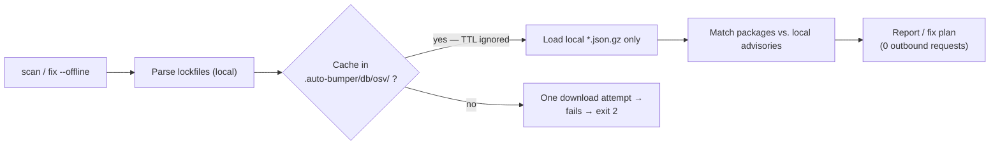

# Auto-Bumper

**Local-first polyglot dependency scanner & auto-fixer.** Scans npm, Rust, Python, and Java projects for vulnerabilities using the [OSV (Open Source Vulnerabilities)](https://osv.dev/) database — no LLM, no API keys, no cloud after initial download. Runs offline once cached.

[](LICENSE)
[](https://bun.sh)
[](https://github.com/sloppylopez/auto-bumper/actions/workflows/ci.yml)

---

## At a Glance

| Feature | Detail |
|---------|--------|
| **What it does** | Finds vulnerable dependencies → proposes minimal version bumps → edits your manifest files |
| **How it knows** | Downloads OSV advisory dumps (~few MB per ecosystem, gzipped) from the public [osv.dev GCS bucket](https://google.github.io/osv.dev/data/) and keeps them cached locally; a small set of vendor GHSA repo advisories comes from the GitHub API; locally-vendored advisory files in `<packageRoot>/local-advisories/` cover disclosures OSV has not ingested yet |
| **Where data lives** | `.auto-bumper/db/osv/` in your current working directory — never leaves your machine |
| **Network needed?** | Only to refresh the OSV advisory database. Each online run sends a lightweight HEAD probe (~ms, no project data) per ecosystem and re-downloads only when the remote dump changed; otherwise the local cache is used (7-day TTL fallback if the probe fails). All matching runs against the local DB — your package list is never sent anywhere. Pass `--offline` to skip even that |
| **LLM involved?** | No. Fixed versions come directly from OSV advisory metadata |

---

## How It Works

```
┌─────────────────────────────────────────────────────────────────────┐
│                              SCAN FLOW                              │
├─────────────────────────────────────────────────────────────────────┤
│                                                                     │
│  Lockfile scanner                                                   │
│        │                                                            │
│        ▼                                                            │
│  Parse packages (pure TS)  -->  PackageRef[]                        │
│        │                                                            │
│        ▼                                                            │
│  Detect ecosystems (npm / pypi / maven / gradle)                    │
│        │                                                            │
│        ▼                                                            │
│  .auto-bumper/db/osv/                                             │
│    cache miss  -->  download OSV zip from GCS (gzip)                │
│    cache hit   -->  read local advisory JSON                        │
│    stale       -->  update-db                                       │
│        │                                                            │
│        ▼                                                            │
│  AdvisoryEntry[]                                                    │
│        │                                                            │
│        ▼                                                            │
│  MATCH ENGINE (matcher.ts)                                          │
│    Maven: compareMavenVersion + matchesMavenRange                   │
│    PyPI:  comparePEP440 + matchesPEP440Range                        │
│    npm/Rust: semver ranges                                          │
│        │                                                            │
│        ▼                                                            │
│  Finding[] sorted by severity                                       │
│        │                                                            │
│        ▼                                                            │
│  REPORTER (reporter.ts)                                             │
│    --format markdown | json                                         │
└─────────────────────────────────────────────────────────────────────┘


┌─────────────────────────────────────────────────────────────────────┐
│                              FIX FLOW                               │
├─────────────────────────────────────────────────────────────────────┤
│                                                                     │
│  Finding[]                                                          │
│        │                                                            │
│        ▼                                                            │
│  buildFixPlan() (fixer.ts)                                          │
│    group by package, pick minimal fix version                       │
│    detectMavenRenames() — OSV + known group migrations              │
│        │                                                            │
│        ▼                                                            │
│  FixPlan: fixable | unfixable | renames                             │
│    expandRenameBundle() — sibling coords in same migration cluster  │
│    health warnings — mixed groups, risky managed constraints        │
│        │                                                            │
│        ▼                                                            │
│  Gates: major (--allow-major) | rename (--allow-renames)            │
│  --yolo: loop apply until clean (combine with gates as needed)      │
│    dry-run shows plan; TTY prompts; CI skips risky                  │
│        │                                                            │
│        ▼                                                            │
│  MANIFEST EDITORS                                                   │
│    gradle-editor / pom-editor / npm-editor                          │
│    cargo-editor / python-editor                                     │
│    backup .auto-bumper-bak before edit                               │
└─────────────────────────────────────────────────────────────────────┘
```

---

## Install & Quick Start

| | |
|---|---|
| **Package** | `@elephantseed/auto-bumper` |
| **Commands** | `scan`, `fix`, `update-db` |

> ### ⚡ The one command that does it all
>
> Don't feel like reading the rest? This single command scans your project (all ecosystems — npm, Rust, Python, Java) and **applies every fix it can make**: patch/minor bumps, **major** version upgrades, dependency **renames** (e.g. Jackson `com.fasterxml.jackson` → `tools.jackson`), and matching **source-code import migrations**. Fully non-interactive — no prompts:
>
> ```bash
> bunx --package @elephantseed/auto-bumper fix -- ./my-project --apply --allow-major --allow-renames --allow-source-migrations
> ```
>
> Each edited file gets a `.auto-bumper-bak` backup first — review with `git diff` afterwards.

> ### 🚀 Want to bring all your Java dependencies up to date?
>
> `fix --latest` (Maven/Gradle) goes beyond security fixes — it bumps **every directly declared dependency** to the newest non-prerelease available in the project's repositories (falling back to Maven Central), even when there are zero vulnerabilities. Prereleases/SNAPSHOTS are excluded, qualifier suffixes are preserved (`guava 33.6.0-jre` → `33.7.2-jre`), major bumps still require `--allow-major`, and targets that don't resolve in the project repositories are rolled back automatically instead of breaking the build:
>
> ```bash
> bunx --package @elephantseed/auto-bumper fix -- ./my-project --latest --dry-run
> bunx --package @elephantseed/auto-bumper fix -- ./my-project --latest --apply --allow-major
> ```
>
> Requires network access (cannot combine with `--offline`). Preview with `--dry-run` first, then run your build/test suite.

Bins ship **inside** the package — not separate npm packages. Use `bunx` or `npx` with `--package`. **Both require [Bun](https://bun.sh) installed** — bins are `#!/usr/bin/env bun` TypeScript, not precompiled Node binaries.

```bash
bunx --package @elephantseed/auto-bumper scan -- ./my-project
```

(`npx --package @elephantseed/auto-bumper …` works the same **if Bun is on PATH**.)

**More examples** (each line is a full command):

```bash
bunx --package @elephantseed/auto-bumper scan -- ./my-project --ecosystem=npm
bunx --package @elephantseed/auto-bumper scan -- ./my-project --format=json
bunx --package @elephantseed/auto-bumper fix -- ./my-project --dry-run
bunx --package @elephantseed/auto-bumper fix -- ./my-project --apply
bunx --package @elephantseed/auto-bumper fix -- ./my-project --yolo --allow-renames
bunx --package @elephantseed/auto-bumper fix -- ./my-project --apply --allow-major --allow-renames --allow-source-migrations
bunx --package @elephantseed/auto-bumper fix -- ./my-project --latest --apply
bunx --package @elephantseed/auto-bumper update-db
```

Windows:

```powershell
bunx --package @elephantseed/auto-bumper scan -- C:\dev\code\my-app
bunx --package @elephantseed/auto-bumper fix -- C:\dev\code\my-app --dry-run
bunx --package @elephantseed/auto-bumper fix -- C:\dev\code\my-app --yolo --allow-renames
```

**Local install** (optional):

```bash
bun add -d @elephantseed/auto-bumper
```

```json
{
  "scripts": {
    "security:scan": "scan",
    "security:fix": "fix",
    "security:update-db": "update-db"
  }
}
```

```bash
bun run security:scan -- .
bun run security:fix -- . --dry-run
```

`fix --dry-run` shows planned bumps/renames. `fix --apply` backs up manifests (`.auto-bumper-bak`), edits files, re-scans; restores backup on failure. **Fix re-scans use `runtimeClasspath` only** (not test deps) to keep yolo loops faster — use `scan` for full runtime+test coverage.

`fix --yolo` implies `--apply` and loops re-scan/apply for **same-package bumps** until clean or stalled (default cap: 10 passes). Majors, coordinate renames, and source migrations still need `--allow-major`, `--allow-renames`, and `--allow-source-migrations` when dry-run shows them. On pass 2+, YOLO does not re-prompt — flags only. Exits **non-zero** if vulnerabilities remain.

**npm / Rust:** re-scans overlay direct deps from `package.json` / `Cargo.toml` onto the lockfile tree so bump loops progress without `npm install`. Transitive-only fixes still need a lock refresh after.

**`--latest`** (Maven/Gradle) bulk-updates every directly declared dependency to its newest non-prerelease in addition to vulnerability fixes — see the 🚀 callout above.

After large **coordinate migrations**, later passes may pin transitive deps via managed constraints. Results are deterministic for a fixed OSV cache and resolved dependency tree; Gradle re-resolve can surface new findings mid-run.

**YOLO is still wet behind the ears** — mixed classpaths, coordinate migrations, and Gradle managed blocks can still stall. Stall messages now say if `--allow-major` or `--allow-renames` blocked progress. Prefer `--dry-run` first; run your build/test suite after.

### Coordinate migrations

Some CVE fixes move to **new Maven coordinates** (new `group:artifact`), not just a higher version. When OSV lists both a **same-major patch** (e.g. Jackson `2.21.4` → `2.21.5`) and a **coordinate migration** (Jackson 3), fix prefers the patch unless you pass `--allow-renames`.

| Ecosystem | Manifest rename | Source rewrite |
|-----------|-----------------|----------------|
| Maven / Gradle | Yes (`--allow-renames`) | Java import prefixes (`--allow-source-migrations`) |
| npm | Yes when OSV lists rename | JS/TS import/require strings |
| pypi | Yes when OSV lists rename | Python import/from lines |
| crates.io | Yes when OSV lists rename | Rust use statements |

- **Scan** warns when old and new groups from the same migration both appear on the classpath.
- **Fix** can rename coords (`--allow-renames`), bundles siblings in the same migration cluster, and prints **health warnings** (mixed groups, managed-block excludes, platform pins that should be plugin/BOM bumps).
- **Jackson 3** (`com.fasterxml.jackson.core` → `tools.jackson.core`): fix auto-adds global excludes for legacy `com.fasterxml.jackson.core` artifacts and pins `tools.jackson` constraints for transitives.
- **Source migrations (opt-in):** `--allow-renames` updates dependency declarations only. `--allow-source-migrations` applies known source rewrite rules from migration clusters (Java import prefixes for Jackson today). Dry-run shows **Planned source migrations**. Does **not** migrate full API breaking changes — only known import paths.
- **Jackson annotations:** Jackson 3 still uses `com.fasterxml.jackson.core:jackson-annotations` **2.x** on the classpath for `@Json*` — the tool does not exclude or rename that artifact.
- **Scan clean ≠ ship ready** — after coordinate migrations, health warnings may still mention mixed groups or managed excludes. Always run `gradlew build` / `mvn verify` and your test suite before merge; scan only reflects the resolved tree at scan time.

`--allow-java-imports` is deprecated; use `--allow-source-migrations`.

Example dry-run output (Jackson is one real migration; others work the same way):

```
# Auto-Bumper Gradle Fix Report

## Planned renames (1)

| From | To | Version | Advisories |
|------|----|---------|------------|
| com.fasterxml.jackson.core:jackson-databind | tools.jackson.core:jackson-databind | 3.1.4 | GHSA-5jmj-h7xm-6q6v |

## Health warnings (2)

- Mixed Maven coordinates during migration: com.fasterxml.jackson.core and tools.jackson.core both on classpath — align related artifacts.
- org.springframework.boot:spring-boot bump to 3.5.14 will likely become a managed constraint — bump platform plugin/BOM instead when possible.
```

---

## CLI Reference

Prefix: `bunx --package @elephantseed/auto-bumper` (or `npx --package …`). Examples below show `<command>` only.

### `scan`

Scan a project for dependency vulnerabilities.

```
scan [path] [options]
```

| Option | Default | Description |
|--------|---------|-------------|
| `[path]` | `.` | Directory containing lockfiles |
| `--format=markdown\|json` | `markdown` | Output format |
| `--ecosystem=<name>` | *(all)* | Filter: `npm`, `crates.io`, `pypi`, `maven`, `gradle` (Gradle = deps from `build.gradle` via `gradlew`) |

**Gradle scan scope:** `runtimeClasspath` + `testRuntimeClasspath` via `gradlew dependencies` (285 pkgs typical Spring app). Not scanned: Gradle plugin classpath, custom configs (e.g. `jaxb` in applied scripts), `annotationProcessor` deps. **`fix --yolo`** uses `runtimeClasspath` only (215 pkgs) — use plain `scan` for full coverage.
| `--offline` | false | No network access at all; use cached advisory DB only |
| `--json` | — | Deprecated alias for `--format=json` (prints a warning) |

**Exit codes:**
- `0` — Clean (no vulnerabilities found)
- `1` — Vulnerabilities detected
- `2` — Error (invalid path, network failure, or no supported lockfile found)

**Example outputs:**

Markdown (default):
```
Scanning: /home/user/my-project
Ecosystems: NPM, MAVEN
Total packages: 147

Matching against 8,432 advisory entries...

🚨 5 vulnerabilities found

CRITICAL (2)
┌───────────────────────────┬───────────┬─────────┬──────────────────────────┐
│ Package                   │ Version   │ Severity│ Summary                  │
├───────────────────────────┼───────────┼─────────┼──────────────────────────┤
│ com.google.guava:guava    │ 31.1.0    │ Critical│ Multiple CVEs in Guava   │
│                           │           │         │ Fixed: 32.0, 33.0        │
│ requests@2.28.0           │ 2.28.0    │ Critical│ CVE-202X-XXXXX           │
│                           │           │         │ Fixed: 2.31.0, 2.32.0    │
└───────────────────────────┴───────────┴─────────┴──────────────────────────┘

HIGH (2)
┌───────────────────────────┬───────────┬─────────┬──────────────────────────┐
│ Package                   │ Version   │ Severity│ Summary                  │
├───────────────────────────┼───────────┼─────────┼──────────────────────────┤
│ org.apache.commons:commons│ 3.14.0    │ High    │ Integer overflow         │
│   -lang                   │           │         │ Fixed: 3.15.0            │
│ tokio@1.34.0              │ 1.34.0    │ High    │ Race condition in timer  │
│                           │           │         │ Fixed: 1.35.0            │
└───────────────────────────┴───────────┴─────────┴──────────────────────────┘
```

JSON (`--format=json`):
```json
[
  {
    "id": "GHSA-xxxx",
    "packageName": "com.google.guava:guava",
    "installedVersion": "31.1.0",
    "fixedVersions": ["32.0.0", "33.0.0"],
    "severity": "CRITICAL",
    "summary": "Multiple CVEs in Guava",
    "aliases": ["CVE-2024-1234"]
  }
]
```

### `fix`

Propose and apply version bumps to fix vulnerabilities.

```
fix [path] [options]
```

| Option | Default | Description |
|--------|---------|-------------|
| `[path]` | `.` | Project directory |
| `--dry-run` | false | Show plan without modifying files |
| `--apply` | false | Write changes to manifest files |
| `--yolo` | false | Implies `--apply`; bump loop until clean or stalled (`--max-iterations` default 10). Exits 1 if not clean. Cannot combine with `--dry-run`. **Experimental** |
| `--latest` | false | Maven/Gradle only — also bump every directly declared dependency to its newest non-prerelease (project repos, then Maven Central). Majors still need `--allow-major`; unresolvable targets roll back. Requires network (not with `--offline`) |
| `--allow-major` | false | Skip interactive prompts for major bumps |
| `--allow-renames` | false | Skip prompts for Maven coordinate renames (group:artifact migrations from OSV / known group moves) |
| `--allow-source-migrations` | false | Apply known source rewrites for applied rename clusters (Java, JS/TS, Python, Rust) |
| `--ecosystem=<name>` | *(all)* | Limit to one ecosystem |
| `--max-iterations=N` | `5` (`10` with `--yolo`) | Safety cap on apply re-scan loops |
| `--strict` | false | Exit `1` when vulnerabilities remain after the run (without `--yolo`) |
| `--exclude=group:pkg` | *(none)* | Packages to skip (repeatable) |
| `--offline` | false | No network access during re-scans |
| `--format=markdown\|json` | `markdown` | Output format |

**Safety guarantees:**
- Backup created before any edit (`.auto-bumper-bak`; skipped if backup already exists for that file)
- Restored automatically on apply failure or uncaught error
- Backup discarded after successful full resolution
- Dry-run mode does not write manifests

**CI note:** non-TTY environments skip interactive prompts. Use `fix --apply` (or `--yolo`) explicitly — `fix` alone in CI only prints the plan and exits.

### `update-db`

Download or refresh the OSV advisory databases.

```
update-db [--ecosystem=<name>]
```

| Option | Default | Description |
|--------|---------|-------------|
| `--ecosystem=<name>` | *(all)* | Refresh only one ecosystem's DB |

**What happens:**
1. Checks local `.auto-bumper/db/osv/` for existing caches
2. For each missing/expired cache: downloads the per-ecosystem OSV dump from the public GCS bucket (osv.dev data)
3. Stores as gzip-compressed JSON (~few MB per ecosystem)
4. Falls back to cached data if download fails (never breaks your workflow)

---

## Supported Ecosystems

| Ecosystem | Scanned Lockfile(s) | Auto-Fix Manifest(s) | Transitive Resolution |
|-----------|---------------------|----------------------|----------------------|
| **npm** | `package-lock.json` (v1/v2/v3), `yarn.lock`, `pnpm-lock.yaml`, `bun.lock` (precedence: package-lock > yarn > pnpm > bun) | `package.json` | Built-in (lockfile has full tree) |
| **Rust** | `Cargo.lock` | `Cargo.toml` | Built-in (lockfile has full tree) |
| **Python** | `requirements.txt`, `poetry.lock` | `requirements.txt`, `pyproject.toml` | Built-in (lockfile has full tree) |
| **Java (Maven)** | `pom.xml` | `pom.xml` | Via `mvn dependency:tree` (requires `mvn`/`mvnw` on PATH) |
| **Java (Gradle)** | `build.gradle`, `build.gradle.kts` | `build.gradle` (Groovy only) | Via `gradlew dependencies` (requires `gradlew` present) |

**Not supported yet:** auto-fix for `build.gradle.kts` (it is scanned, but edits target Groovy `build.gradle`), `libs.versions.toml`, Gradle version catalogs.

### Deduplication rules

When multiple manifests exist in the same directory:
- `poetry.lock` + `requirements.txt` → poetry.lock wins (authoritative)
- Multiple npm lockfiles → precedence `package-lock.json` > `yarn.lock` > `pnpm-lock.yaml` > `bun.lock` (bun.lock is the Bun-native fallback, used only when none of the others exist)
- `pom.xml` + `build.gradle` → both scanned (dual Java layouts); use `--ecosystem=maven` or `--ecosystem=gradle` to force one
- Different ecosystems → all scanned independently

---

## Programmatic API

Use auto-bumper as a library in your own tools:

```ts
import {
  runAutoBumperScan,
  buildFixPlan,
  reportMarkdown,
} from "@elephantseed/auto-bumper";

// Scan
const result = await runAutoBumperScan("/path/to/project");
console.log(`Found ${result.findings.length} vulnerabilities`);
console.log(reportMarkdown(result.findings));

// Build fix plan
const plan = buildFixPlan(result.findings);
plan.fixable.forEach(c => {
  console.log(
    `${c.packageName}: ${c.installedVersion} → ${c.targetVersion}`
  );
});

// Filter by ecosystem
const npmOnly = await runAutoBumperScan("/path/to/project", {
  ecosystemFilter: "npm",
});
```

### Available exports

| Module | Exports |
|--------|---------|
| **scan** | `runAutoBumperScan()` — full scan pipeline (advisory loading, matching, reporting) |
| **ghsa** | `loadRepoAdvisories()`, `getWatchedRepos()` — vendor-published repo advisories (netty, jackson) from the GitHub API; watchlist in `<cacheRoot>/ghsa-repos.json` |
| **local-advisories** | `loadLocalAdvisories()`, `getLocalAdvisoriesDir()` — locally-vendored OSV-format advisory files in `<packageRoot>/local-advisories/*.json`; always loaded, no network involved |
| **fixer** | `buildFixPlan(findings[])` → `{ fixable[], unfixable[], renames[] }` |
| **matcher** | `matchVulnerabilities(packages[], advisories[])` → `Finding[]` |
| **reporter** | `reportMarkdown()`, `reportJson()`, `reportSummary()` |
| **editors** | `applyNpmBumps()`, `applyCargoBumps()`, `applyMavenBumps()`, etc. |
| **types** | `Finding`, `PackageRef`, `FixCandidate`, `FixPlan` |

---

## Cache Architecture

```
.auto-bumper/
└── db/
    └── osv/
        ├── NPM.json.gz          ← ~2MB compressed
        ├── CRATES.IO.json.gz    ← ~1.5MB compressed
        ├── PyPI.json.gz         ← ~1MB compressed
        ├── Maven.json.gz        ← ~3MB compressed
        ├── Maven-orphan.json.gz ← package-less OSV CVEs bridged onto Maven coordinates
        └── repo-advisories.json.gz ← vendor-published GHSA advisories (GitHub API)
```

- **Location:** Always under current working directory
- **Format:** Gzip-compressed JSON arrays of OSV advisory entries
- **Freshness:** every online run HEAD-probes each remote dump by ETag — if the remote object changed since the cache was written, it is re-downloaded immediately; otherwise the local cache is used. If the probe fails (no network), the 7-day TTL applies (configurable via `CACHE_TTL_MS` constant)
- **GitHub repo advisories:** vendor-published advisories missing from the OSV bulk DB (e.g. netty, FasterXML jackson) are fetched from the GitHub API for a small watched-repo list and cached as `repo-advisories.json.gz`. Override the watchlist with `<cacheRoot>/ghsa-repos.json` (JSON array of `"owner/repo"`)
- **Fallback strategy:** Stale cache > no cache. If download fails, uses whatever is cached
- **Disk usage:** ~8MB total across all four ecosystems
- **Local vendored advisories:** disclosures not yet in the OSV bulk dump can be added as OSV-format JSON files under `<packageRoot>/local-advisories/` (see `Maven.json`, currently the 8 BouncyCastle 1.86 CVEs). Loaded on every scan, works offline, never fetched

---

## Offline Mode (`--offline`)

Pass `--offline` to `scan` or `fix` to match vulnerabilities **only against the local advisory cache** — the tool makes no outbound requests for vulnerability data:



What each data source does offline:

| Data source | Online behavior | `--offline` behavior |
|-------------|-----------------|----------------------|
| Per-ecosystem OSV dumps (GCS) | Fresh cache used; stale/missing → download | Cache used **regardless of TTL**; if no cache file exists at all, one download is attempted and the scan exits `2` when it fails |
| Orphan-CVE bridge (Maven) | Same as above | Local cache or empty — never fetched |
| GHSA vendor repo advisories (netty/jackson) | Fetched + cached | **Skipped entirely** — even a fresh local `repo-advisories.json.gz` is not read, so those vendor GHSAs are not matched offline |
| Local vendored advisories (`local-advisories/*.json`) | Loaded from disk on every scan | **Always loaded** — pure local files, no fetch involved |

Practical notes:

- Warm the cache once while online (`update-db` or any regular scan); afterwards `--offline` keeps working indefinitely because TTL checks are bypassed.
- Transitive resolution still runs your local `gradlew`/`mvn`; a cold build cache may let *your build tool* touch the network — that's outside this tool's own fetches.

---

## CI Integration

The tool returns non-zero exit codes on findings, making it ideal for CI gates:

```yaml
# GitHub Actions — scan gate (needs Bun)
- uses: oven-sh/setup-bun@v2
- name: Check dependencies
  run: bunx --package @elephantseed/auto-bumper scan -- . --format=json

# Apply fixes in CI (non-TTY — must pass --apply)
- name: Apply security fixes
  run: bunx --package @elephantseed/auto-bumper fix -- . --apply --allow-major
```

Or pipe JSON into custom logic:

```bash
bunx --package @elephantseed/auto-bumper scan -- . --format=json | \
  jq '[.[] | select(.severity == "CRITICAL")] | length'
```

---

## Security Model

- **No telemetry** — nothing is sent from your machine
- **No LLM** — fixed versions come directly from OSV metadata
- **No credentials** — reads from the public [GitHub Advisory Database](https://github.com/github/advisory-database)
- **Backups first** — every edit creates a `.auto-bumper-bak` (legacy `.depender-bak` still restored)
- **Deterministic** — given the same lockfile + advisory DB, output is identical

---

## FAQ

**Q: `bunx scan` returns 404**  
A: The published package is `@elephantseed/auto-bumper`. Use `bunx --package @elephantseed/auto-bumper scan -- <path>` (see **Install & Quick Start**).

**Q: Why Bun?**  
A: Bun's native TypeScript execution means zero compilation step. The package ships `.ts` source directly (no bundling). It also gives us access to Bun's fast `fetch` and `fs` APIs out of the box.

**Q: Can I use this with Node.js?**  
A: Install [Bun](https://bun.sh). Bins are Bun TypeScript scripts — `npx`/`bunx` invoke them via Bun, not plain Node.

**Q: How does this differ from Dependabot / Renovate?**  
A: Those are PR-driven bots that live in your repo. This is a local CLI/library you run on demand — useful for pre-commit checks, CI gates, or ad-hoc auditing. No account setup needed.

**Q: What about transitive dependencies?**  
A: npm's `package-lock.json` already contains the full resolved tree. Rust's `Cargo.lock` too. Java needs `mvn`/`gradlew` installed to resolve transitively; otherwise falls back to direct deps only.

**Q: My project uses both Maven and Gradle — which wins?**  
A: Both are scanned (dual Java layouts). Use `--ecosystem=gradle` or `--ecosystem=maven` to force one.

---

## Development

```bash
git clone https://github.com/sloppylopez/auto-bumper.git
cd auto-bumper
bun install

# Typecheck
bun run typecheck

# Run tests
bun test

# Manual CLI testing
bun run scan -- /path/to/project
bun run fix -- /path/to/project --dry-run
```

## License

MIT © Elephant Seed
